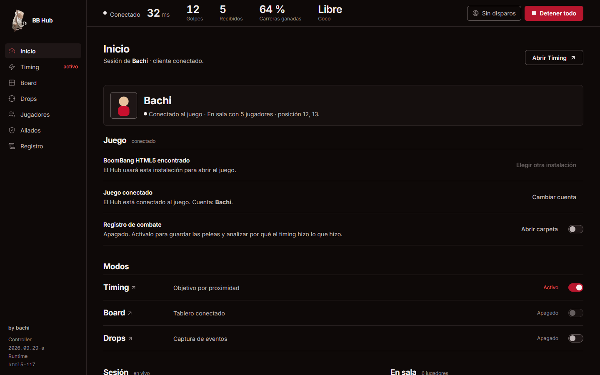
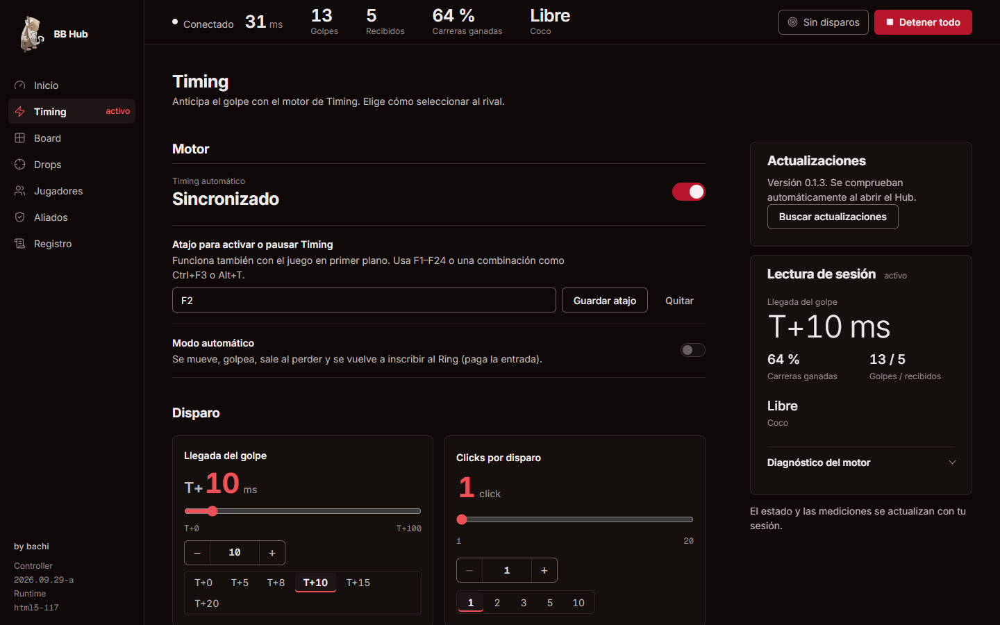
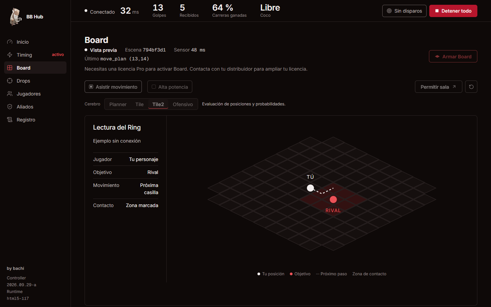
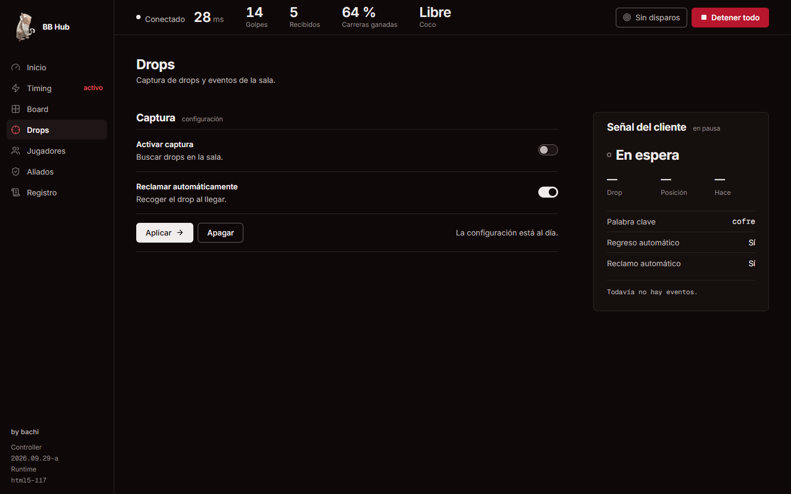
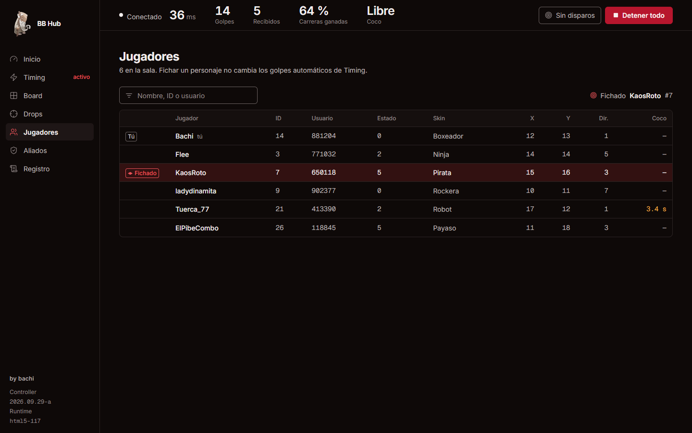
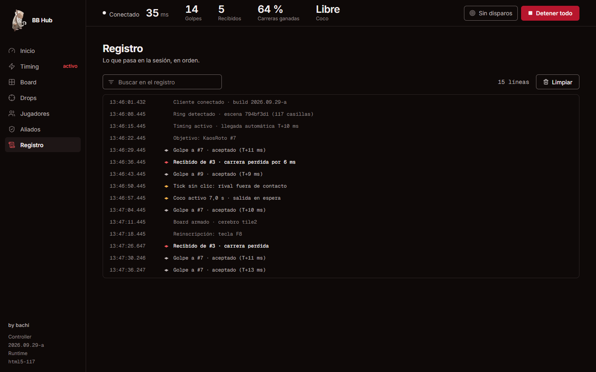

# BB Hub

Aplicación de escritorio comercial (Windows x64) que se conecta al cliente oficial de **BoomBang HTML5**: lo abre, inyecta un runtime propio en el juego y lo controla desde una interfaz externa. Ofrece **Timing** (golpe anticipado según la llegada del paquete del rival), **Board** (lectura del ring con un planificador táctico), **Drops**, gestión de aliados y registro de combate. Se distribuye con instalador NSIS, licencias **Basic/Pro de Cryptlex** y actualizaciones automáticas. La versión actual es la **0.1.26**.



## Stack

| Área | Tecnología |
| --- | --- |
| Escritorio | Electron 44, Node.js 24 |
| UI | React 18 + Vite 5, lucide-react |
| Control del juego | Chrome DevTools Protocol (playwright-core) y WebSocket local |
| Licencias | Cryptlex LexActivator (Basic/Pro, activación por equipo) |
| Protección | javascript-obfuscator + bytecode V8 (bytenode) y Electron Fuses |
| Distribución | electron-builder (NSIS), updater propio con verificación del instalador |
| Board | TypeScript, Express + ws, simulador en worker threads y Vitest |

## Arquitectura

```
┌────────────────────────────── BB Hub (Electron) ──────────────────────────────┐
│ main.cjs ── license/gate.cjs (Cryptlex) ── updater.cjs                        │
│    │                                                                          │
│    ├── controller-core.cjs  servidor WS local (:9999 o puerto libre),         │
│    │                        estado de sesión, Timing, Drops, aliados, logs    │
│    │                                                                          │
│    ├── game/game-launcher.cjs ─ abre BoomBangHTML5.exe con CDP, inicia sesión │
│    │                            (credenciales cifradas con DPAPI/safeStorage) │
│    │        └─ inyecta flash_runtime + ring_scene en el frame del juego       │
│    │                                                                          │
│    └── preload.cjs ── UI React (src/App.jsx)  ← IPC con origen validado        │
└───────────────────────────────────────────────────────────────────────────────┘
          ▲  WebSocket (estado 4 Hz, comandos)        │
          │                                           ▼
  runtime inyectado en el juego  ───────────>  ring-board (TypeScript)
  (lee la escena y el tráfico, ejecuta)        solver táctico + simulador
```

- **`controller-core.cjs`** es el núcleo: recibe el estado del runtime inyectado, decide las acciones de Timing y Drops y expone un snapshot a la UI. Si el puerto 9999 está ocupado usa otro libre, y solo marca la conexión como lista cuando recibe mensajes del runtime en su propio puerto.
- **`game/`** reemplaza los scripts manuales de la primera versión: localiza la instalación del cliente, lo abre con depuración remota, inyecta el runtime y lo conecta al controller. El usuario final no necesita Node, Playwright ni scripts.
- **`ring-board/`** es el módulo de Board: modelo del tablero isométrico, resolución de enfrentamientos, planificador de movimiento y de golpe (`tactical-planner`, `contact-solver`, `fire-controller`), un worker para el cálculo y un simulador para comparar estrategias con partidas grabadas.
- **`native-client/`** es un experimento de conexión directa al servidor del juego por WebSocket. Reimplementa el handshake ECDH y el cifrado ChaCha20 del cliente oficial para eliminar el jitter que agrega la cadena navegador → iframe → worker.

## Capturas

Las capturas son del modo demo de la UI (`npm run dev` en un navegador, sin juego conectado), con datos de ejemplo.

| Timing | Board |
| --- | --- |
|  |  |

| Drops | Jugadores | Registro |
| --- | --- | --- |
|  |  |  |

## Seguridad y distribución

- **Licencias:** Cryptlex decide el acceso Basic/Pro. El cliente no guarda tokens de administración, y `product.dat` solo identifica el producto.
- **Núcleo protegido:** `scripts/protect.cjs` ofusca con un perfil liviano (para no penalizar el timing) y compila a bytecode V8. Las Fuses de Electron desactivan los puntos de entrada de depuración en el binario empaquetado.
- **IPC:** el preload valida origen y frame. El bypass de desarrollo queda deshabilitado en producción; lo verifica `qa/runtime-security.cjs`.
- **Credenciales del juego:** se guardan cifradas con la clave del usuario de Windows (DPAPI), nunca en texto plano.
- **Actualizaciones:** el updater compara versiones y verifica el instalador descargado antes de ejecutarlo.
- **Releases:** cada entrega es un commit con su etiqueta `vVERSION` y un manifiesto en `docs/releases/`. Los instaladores y hashes se publican en un repositorio separado. Ver [`controller-electron/RELEASE.md`](controller-electron/RELEASE.md) y [`SECURITY-RELEASE.md`](controller-electron/SECURITY-RELEASE.md).

## Desarrollo

```powershell
cd controller-electron
npm ci
npm run dev        # UI en el navegador con datos de demo
npm run electron   # Hub completo en modo desarrollo
npm run dist       # build + protección + instalador NSIS
```

```bash
cd ring-board && npm i && npm test
```

## Pruebas

Resultado del 28/10/2026, sobre este commit:

| Suite | Resultado |
| --- | --- |
| `qa/client-discovery`, `port-conflict`, `runtime-security` | OK |
| `qa/allies`, `prime-0126`, `timing-shot-config`, `step-click-metrics`, `pro-hotkey-updater`, `punch-isolation-host` | OK (30 grupos de verificación) |
| `qa/avatar-regression`, `board-auto-regression`, `*-smoke` | Necesitan el binario de Electron o el paquete compilado; no se corrieron en este entorno |
| `ring-board` (Vitest) | 33 de 46 en verde. Los 13 restantes corresponden a tests del planificador escritos para una versión anterior de los "cerebros" (uno importa un módulo que ya se reemplazó); quedan para reescribir |

Las pruebas de timing controlan decisiones y protocolo con un reloj simulado; no miden la latencia real de la red.

## Documentación

- [`docs/OPERACION.md`](docs/OPERACION.md): compilación, versiones y recuperación.
- [`docs/PROJECT_LAYOUT.md`](docs/PROJECT_LAYOUT.md): mapa del repositorio.
- [`controller-electron/CRYPTLEX-SETUP.md`](controller-electron/CRYPTLEX-SETUP.md): configuración de licencias.
- [`docs/timing-investigacion-2026-10-05.md`](docs/timing-investigacion-2026-10-05.md): investigación del motor de Timing.

## Licencia

Código privado y propietario. Todos los derechos reservados.
